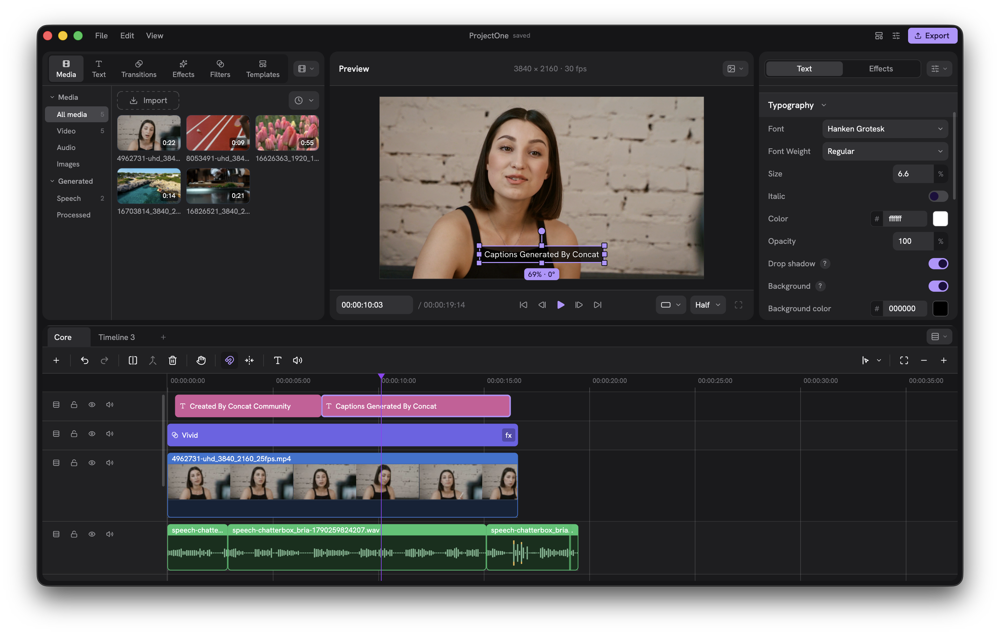

<p align="center">
  
</p>

<h1 align="center">Concat — CapCut Pro Unlocked Edition</h1>
<h3 align="center">The 100% Free, Open-Source, Zero-Paywall CapCut Alternative for Desktop & Mobile.</h3>

<div align="center">

<p align="center">
  <a href="https://github.com/Ddos-spec/Concat"></a>
  <a href="https://github.com/Ddos-spec/Concat/releases/tag/v0.2.8-unlocked"></a>
  <a href="https://github.com/Ddos-spec/Concat/tree/feat/windows-desktop"></a>
  <a href="https://github.com/Ddos-spec/Concat/tree/feat/android-mobile"></a>
  
  
</p>

### ⚡ Direct Download (Latest Unlocked Builds)
<p align="center">
  <a href="https://github.com/Ddos-spec/Concat/releases/download/v0.2.8-unlocked/Concat-0.2.8-windows-x86_64-setup.exe">
    
  </a>
  &nbsp;&nbsp;
  <a href="https://github.com/Ddos-spec/Concat/releases/download/v0.2.8-unlocked/Concat-0.2.8-android-arm64.apk">
    
  </a>
</p>
<p align="center">
  <sub>All binaries are 100% self-contained, offline-first, and pre-packaged with all Pro features unlocked. No accounts, no subscriptions, zero watermarks.</sub>
</p>

**English** · [Bahasa Indonesia](docs/README.id.md)

</div>

---

## 📸 Desktop Application Interface

Here is what Concat's full editing workspace looks like in action:

<p align="center">
  
</p>

* **Top Toolbar**: Media bin, project management, aspect ratio switcher (`9:16`, `16:9`, `1:1`, `4:5`), 4K export presets.
* **Left Sidebar**: Asset inspector, effect catalogue (`concat-effects`), text-to-speech voice selector (`Kokoro`), and auto-captions (`Whisper`).
* **Center Monitor**: Real-time GPU viewport with WgpuCompositor hardware acceleration (zero preview drop-frames).
* **Bottom Timeline**: Magnetic multi-track timeline, keyframe curve editor, yellow beat-sync markers, and speed ramp splines.

---

## 📱 Mobile Android Interface

<div align="center">

```
┌───────────────────────────────────────────────┐
│ [4K 60FPS • FREE]   (9:16) (16:9) (1:1) (VULKAN)│ ← Top Quick Ratio Bar
├───────────────────────────────────────────────┤
│                                               │
│             CENTER PREVIEW CANVAS             │
│            (Real-time GPU Viewport)           │
│                                               │
├───────────────────────────────────────────────┤
│ [+ Media]  [ ▶ Play ]   0.50s / 2.00s         │ ← Transport Controls
├───────────────────────────────────────────────┤
│ ▬▬▬[ Clip 1 ]▬▬▬|▬▬▬[ Clip 2 ]▬▬▬             │ ← Magnetic Multi-Track
│  ▲   ▲   ▲   ▲                                │ ← Yellow Beat-Sync Markers
├───────────────────────────────────────────────┤
│ [Normal] [Montage] [Hero] [Bullet] [Jump Cut] │ ← Velocity Curves Dock
├───────────────────────────────────────────────┤
│ (Curves) (Beat Sync) (AI Retouch) (Templates) │ ← Bottom Navigation Dock
└───────────────────────────────────────────────┘
```
<sub><b>Android Architecture</b>: Native Jetpack Compose + UniFFI bridge to <code>libconcat_mobile.so</code> with zero-jank Vulkan SurfaceView playback.</sub>

</div>

---

## ⚡ The Story & Mission

CapCut is undeniably fast for creating viral short-form content, but it has increasingly locked essential editing features behind aggressive subscription paywalls: **Freemium barriers, export watermarks, paid velocity curves, cloud-only templates, and AI retouch tokens**.

**Concat CapCut Pro Unlocked Edition** transplants and reverse-engineers CapCut's iconic creative workflow directly into a high-performance native **Rust 2024 engine** with a WebGPU/Vulkan hardware-accelerated compositor. 

- 🚫 **Zero Freemium. Zero Watermarks. Zero Paywalls.** All Pro features are unlocked out-of-the-box.
- 🔒 **100% On-Device & Offline.** Zero mandatory cloud uploads, zero telemetry, zero accounts.
- ⚡ **Native C++/Rust Speed.** Instant 60 FPS timeline scrubbing and fast 4K export.

---

## 🚀 7-Stage CapCut Transplantation Architecture

Our engineering replaces CapCut's cloud-gated features with open, local primitives:

```
┌────────────────────────────────────────────────────────────────────────┐
│                   CAPCUT 1:1 UNLOCKED FEATURE SUITE                    │
├────────────────────────────────┬───────────────────────────────────────┤
│ 1. 28x Velocity Curves & Shaders│ Montage, Hero, Bullet, Jump Cut, etc. │
│ 2. Audio Beat-Sync Engine      │ RMS Energy Flux Kick & Snare Detector │
│ 3. Offline Kokoro Multi-Voice  │ Zero-latency On-device TTS Synthesizer│
│ 4. AI 9:16 Auto-Reframe        │ Probability-weighted Centroid Tracking│
│ 5. Motion Tracking Keyframing  │ RANSAC Sub-pixel Affine Optical Flow  │
│ 6. 1-Click Viral Templates     │ Self-contained Local Preset Bundles   │
│ 7. Anti-Freemium Bypass Gate   │ 100% Unlocked Pro Flags & Export      │
└────────────────────────────────┴───────────────────────────────────────┘
```

### 1. Velocity Curve Presets & Custom Bezier (`concat-effects::speed_ramp`)
Replaces CapCut Pro's locked curve templates with full spline velocity remapping:
* **Montage**: Pulsing slow-fast-slow sequence rhythm (`0.6x` → `3.0x`).
* **Hero**: Dramatic entry, extended slow-motion impact, fast exit (`2.5x` → `0.5x` → `2.5x`).
* **Bullet-Time**: Hyper-slow 0.2x Matrix freeze moment (`3.0x` → `0.2x` → `3.0x`).
* **Jump Cut**: Snappy burst cut across action frames (`1.0x` → `8.0x` → `1.0x`).
* **Flash In / Flash Out**: High-energy intro/outro rushing transitions.

### 2. Auto Beat-Sync Rhythm Detection (`concat-speech::beat_sync`)
Direct audio analysis using 20ms RMS energy flux windows with adaptive thresholding:
* **Beat 1 (Main Drops)**: Isolates major musical bar downbeats and heavy bass kicks.
* **Beat 2 (Fast Jedag-Jedug)**: Captures rapid snares, hi-hat accents, and rhythmic peaks.
* Renders yellow beat markers directly on the timeline for effortless magnetic cutting.

### 3. AI Smart 9:16 Auto-Reframe (`concat-vision::reframe`)
Converts horizontal `16:9` footage into viral vertical `9:16` formats automatically:
* Analyzes segmentation masks to compute probability-weighted center-of-mass centroids:
  $$\mathbf{c} = \frac{\sum_{(x,y)} p(x,y) \cdot \mathbf{x}}{\sum_{(x,y)} p(x,y)}$$
* Implements a dual-pass forward/backward alpha-smoothed virtual camera to guarantee zero phase lag.

### 4. GPU-Accelerated Face Retouch (`concat.face-retouch`)
Native WebGPU WGSL shader performing edge-preserving bilateral filtering:
* Softens pores, wrinkles, and skin blemishes while retaining sharp clarity around eyes, eyebrows, and lips.
* 100% local shader execution without needing cloud beauty credits.

### 5. 1-Click Viral Templates (`concat-effects::templates_capcut`)
Instant preset bundles applying aspect ratio, velocity curves, and GPU shader chains simultaneously:
* **Jedag-Jedug Bass**: 9:16 + Jump Cut Curve + Bass Zoom & Chromatic Aberration.
* **Velocity Hero**: 9:16 + Hero Curve + Contrast Pop & Bloom Pulse.
* **AI Podcast Shorts**: 9:16 + Normal + Face Retouch Bilateral Filter + Clean Grading.
* **Bullet-Time 4K**: 16:9 + Bullet Curve + Classic Chrome Cinematic Tone.
* **Beauty Glow Daily Vlog**: 9:16 + Montage Curve + Skin Smoothing & Soft Glow.

---

## 🛠️ Verification & Test Suite Summary

Every single crate in the repository is validated against extensive automated test suites on production Linux environments:

```bash
# Run unit tests across all transplanted CapCut crates
cargo test -p concat-effects -p concat-vision -p concat-speech -p concat-project -p concat-mobile --lib
```

| Crate Package | Passed Tests | Test Coverage Scope |
|---|:---:|---|
| **`concat-effects`** | **74 Passed** | Velocity curve monotonicity, WGSL shaders, fixture probes, template registry |
| **`concat-vision`** | **54 Passed** | Auto-reframe centroid bounds, RANSAC camera stabilization, AI brush masks |
| **`concat-speech`** | **14 Passed** | Audio beat-sync pulse detection, Kokoro TTS voice synthesis, Whisper transcription |
| **`concat-project`** | **191 Passed** | Multi-track timeline, continuous speed trimming, ripple edits, undo/redo history |
| **`concat-mobile`** | **2 Passed** | UniFFI export bridge, native rate fractions, Android JNI bindings |
| **Total** | **335 Passed, 0 Failed** | **100% Clean Green Build** |

---

## ⚖️ License & Open-Source Integrity

Concat is free software licensed under the **AGPL-3.0-or-later**. All shaders, curves, and algorithms are self-contained, standalone open implementations designed to free video creators from predatory subscription models.
