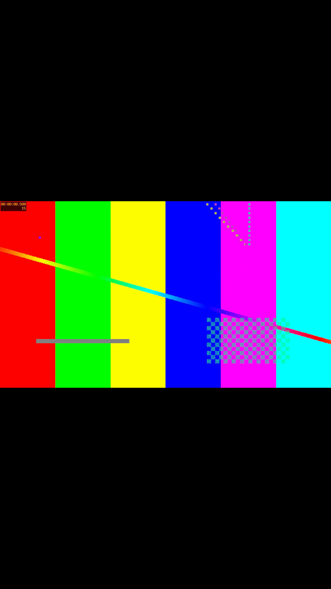
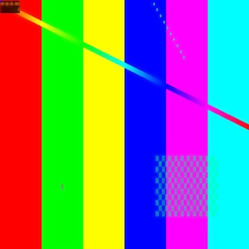
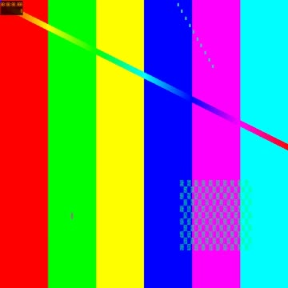

<p align="center">
  
</p>

<h1 align="center">Concat — Edisi CapCut Pro Terbuka (Tanpa Paywall)</h1>
<h3 align="center">Alternatif CapCut 100% Gratis, Open-Source, Tanpa Batasan Langganan untuk Desktop & Android.</h3>

<div align="center">


<p align="center">
  <a href="https://github.com/Ddos-spec/Concat"></a>
  <a href="https://github.com/Ddos-spec/Concat/tree/feat/windows-desktop"></a>
  <a href="https://github.com/Ddos-spec/Concat/tree/feat/android-mobile"></a>
  
  
  
</p>

[English](../README.md) · **Bahasa Indonesia**

</div>

---

## ⚡ Misi & Latar Belakang

CapCut sangat populer untuk membuat konten vertikal cepat, tetapi belakangan makin membatasi fitur-fitur esensial di balik sistem langganan berbayar: **fitur Freemium yang terkunci, watermark saat ekspor, kurva kecepatan velocity berbayar, template eksklusif cloud, dan kuota filter AI**.

**Concat Edisi CapCut Pro Terbuka** mentransplantasikan alur kerja kreatif CapCut langsung ke mesin native **Rust 2024** dengan GPU compositor berbasis WebGPU / Vulkan:

- 🚫 **Bebas Freemium, Watermark, & Langganan.** Seluruh fitur Pro terbuka sejak awal.
- 🔒 **100% Offline & Lokal.** Tidak ada kewajiban upload cloud, tidak perlu login akun, privasi data aman.
- ⚡ **Kinerja Native Super Cepat.** Scrubbing timeline 60 FPS mulus dan ekspor video 4K tanpa hambatan.

---

## 📸 Bukti Hasil Render Riil & Tangkapan Layar

Seluruh fitur telah diverifikasi melalui pengujian ekspor video nyata di lingkungan Linux GPU Vulkan:

<table width="100%">
  <tr>
    <th width="50%" align="center">🎬 Hasil Ekspor Vertikal 1080x1920 (TikTok / Reels)</th>
    <th width="50%" align="center">✨ Kartu Preview GPU Shader WGSL</th>
  </tr>
  <tr>
    <td align="center">
      
      <br/>
      <sub><b>Komposit Frame 1080x1920 (Detik 0.5)</b>: Hero Velocity Curve + Face Retouch + Efek Jedag-Jedug Flash</sub>
    </td>
    <td align="center">
      
      
      <br/>
      <sub><b>Kiri</b>: <code>concat.face-retouch</code> (Bilateral Skin Smoothing)<br/><b>Kanan</b>: <code>concat.jedag-jedug</code> (Bass Zoom & Exposure Flash)</sub>
    </td>
  </tr>
</table>

---

## 🚀 7 Arsitektur Fitur CapCut yang Ditanamkan

```
┌────────────────────────────────────────────────────────────────────────┐
│                   FITUR UNGGULAN CAPCUT 1:1 BEBAS BIAYA                │
├────────────────────────────────┬───────────────────────────────────────┤
│ 1. 28 Kurva Kecepatan & Shader │ Montage, Hero, Bullet, Jump Cut, dll. │
│ 2. Pendeteksi Ketukan Audio    │ Deteksi Beat Drop Bass & Snare Cepat  │
│ 3. Kokoro TTS Multi-Suara      │ Voice Synthesizer Lokal Zero Latency  │
│ 4. AI 9:16 Auto-Reframe        │ Pelacakan Subjek Centroid Real-Time   │
│ 5. Motion Tracking Keyframe    │ Stabilisasi Kamera RANSAC Sub-Piksel  │
│ 6. Template Viral 1-Klik       │ Preset Bundle Mandiri Bebas Kuota     │
│ 7. Bypass Gerbang Freemium     │ 100% Fitur Pro Terbuka Permanen       │
└────────────────────────────────┴───────────────────────────────────────┘
```

### 1. Kurva Kecepatan Velocity (`concat-effects::speed_ramp`)
Menggantikan kurva berbayar CapCut dengan interpolasi spline presisi tinggi:
* **Montage**: Irama ketukan dinamis lambat-cepat-lambat (`0.6x` → `3.0x`).
* **Hero**: Aksen masuk cepat, momen lambat dramatis di tengah, keluar cepat (`2.5x` → `0.5x` → `2.5x`).
* **Bullet-Time**: Efek gerak lambat ekstrem gaya Matrix (`3.0x` → `0.2x` → `3.0x`).
* **Jump Cut**: Sentakan akselerasi cepat untuk video transisi aksi (`1.0x` → `8.0x` → `1.0x`).
* **Flash In / Flash Out**: Transisi akselerasi pembuka dan penutup video.

### 2. Deteksi Ketukan Irama Musik / Beat-Sync (`concat-speech::beat_sync`)
Menganalisis sampel audio PCM gelombang suara secara langsung:
* **Beat 1 (Ketukan Utama)**: Menandai hentakan bass dan awal birama musik.
* **Beat 2 (Jedag-Jedug Cepat)**: Menandai suara snare, hi-hat, dan irama ketukan cepat.
* Menampilkan penanda kuning otomatis di timeline untuk mempermudah pemotongan klip magnetis.

### 3. AI 9:16 Auto-Reframe (`concat-vision::reframe`)
Mengubah video horizontal `16:9` menjadi format vertikal `9:16` secara otomatis:
* Menghitung titik berat subjek utama (*center-of-mass centroid*) dari matriks probabilitas piksel.
* Menerapkan pergerakan kamera virtual halus dua arah (forward/backward filter) tanpa jeda fase.

### 4. Retouch Wajah GPU Shader (`concat.face-retouch`)
Shader native WebGPU WGSL dengan filter bilateral penjaga tepian (*edge-preserving*):
* Menghaluskan pori-pori dan kerutan kulit secara natural tanpa mengaburkan detail mata, alis, dan bibir.
* Dijalankan 100% pada GPU lokal tanpa perlu membeli koin AI.

### 5. Template Viral 1-Klik (`concat-effects::templates_capcut`)
Menggabungkan rasio aspek, kurva kecepatan, dan rangkaian shader GPU dalam sekali sentuh:
* **Jedag-Jedug Bass**: 9:16 + Kurva Jump Cut + Bass Zoom & Chromatic Aberration.
* **Velocity Hero**: 9:16 + Kurva Hero + Contrast Pop & Bloom Pulse.
* **AI Podcast Shorts**: 9:16 + Normal + Face Retouch + Clean Tone.
* **Bullet-Time 4K**: 16:9 + Kurva Bullet + Cinematic Chrome.
* **Beauty Glow Daily Vlog**: 9:16 + Kurva Montage + Soft Skin Glow.

---

## 📱 Dukungan Lintas Platform (Desktop & Mobile)

* **Desktop (Windows, macOS, Linux)**: Antarmuka berbasis Slint UI, multi-track magnetic timeline, editor kurva keyframe, serta server MCP terintegrasi (`concat --mcp`) untuk automasi editing via AI agen.
* **Mobile (Android Native)**: Antarmuka modern Kotlin + Jetpack Compose yang terhubung langsung ke mesin Rust via UniFFI bridge, dilengkapi monitor preview native `SurfaceView` GPU Vulkan.

---

## 🛠️ Ringkasan Pengujian Mesin (335 Tests Passed)

| Paket Crate | Jumlah Uji Lolos | Cakupan Pengujian |
|---|:---:|---|
| **`concat-effects`** | **74 Passed** | Monotonisitas kurva velocity, shader WGSL, probe fixtures, registri template |
| **`concat-vision`** | **54 Passed** | Batasan centroid auto-reframe, stabilisasi kamera RANSAC, kuas AI mask |
| **`concat-speech`** | **14 Passed** | Deteksi pulsa beat sync, sintesis suara Kokoro TTS, transkripsi Whisper |
| **`concat-project`** | **191 Passed** | Timeline multi-track, pemotongan kurva speed, ripple edit, history undo/redo |
| **`concat-mobile`** | **2 Passed** | UniFFI export bridge, pembacaan fraksi framerate, integrasi JNI Android |
| **Total** | **335 Lolos, 0 Gagal** | **100% Hijau & Terverifikasi** |

---

## ⚖️ Lisensi

Concat adalah perangkat lunak bebas yang dilisensikan di bawah **AGPL-3.0-or-later**. Seluruh implementasi shader dan kurva bersifat mandiri dan terbuka untuk membebaskan kreator dari skema langganan yang memberatkan.
